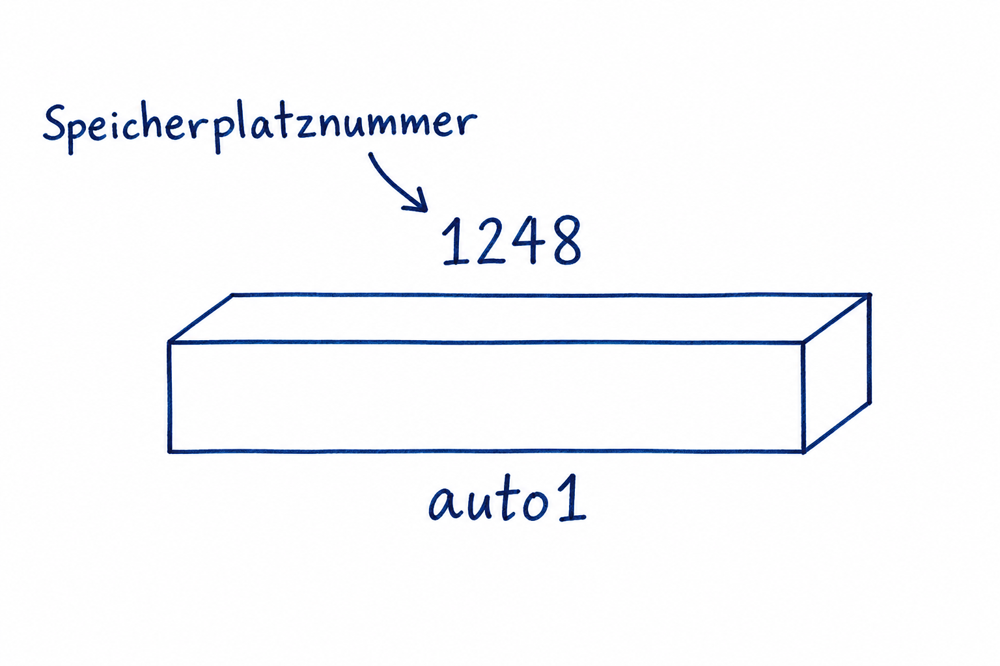
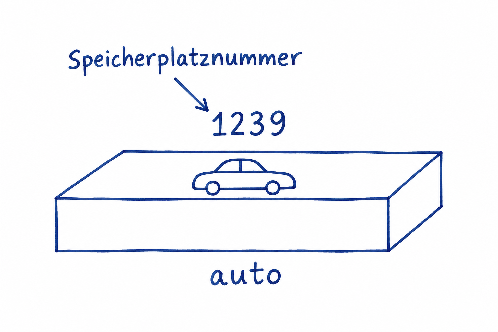
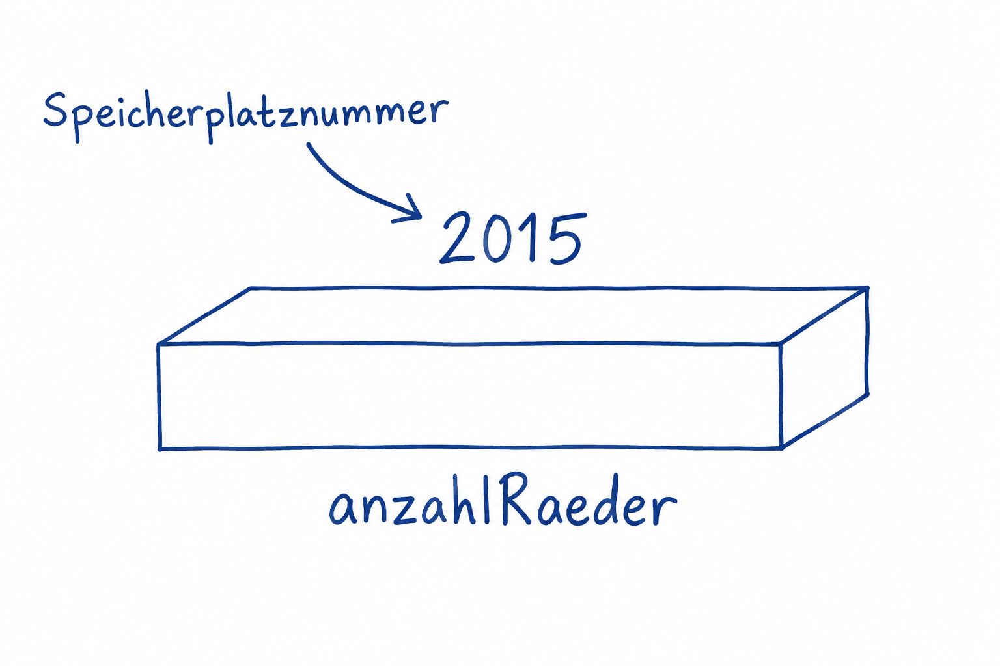
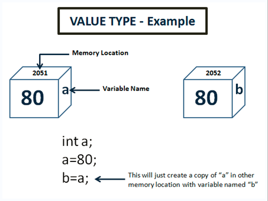
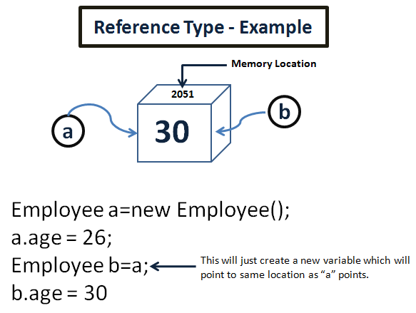
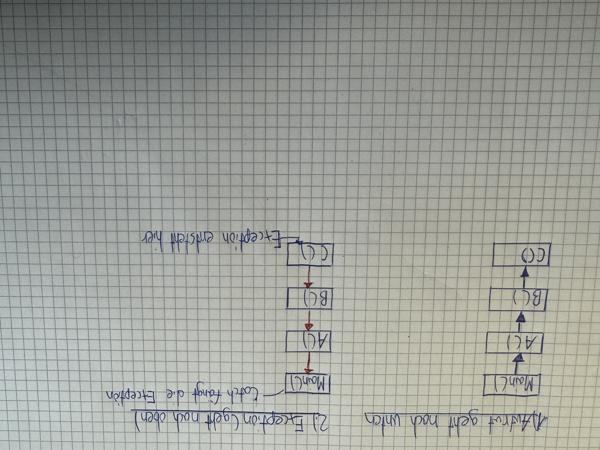

# Zusammenfassung

## 1. Klasse

Eine Klasse ist ein Bauplan für Objekte.

**Syntax:**

```csharp
class ClassName
{
    // Inhalt der Klasse
}
```

Beispiel:

```csharp
class Person
{
}
```

## 2. Objekt

Ein Objekt ist eine konkrete Instanz einer Klasse.

**Syntax:**

```csharp
ClassName name;
```

Damit wird eine Variable namens `name` vom Typ `ClassName` deklariert, aber noch kein Objekt erstellt. Die Objekterstellung mit `new` steht in Abschnitt 3.

**Beschriftetes Beispiel aus der Notiz:**

<table>
<tr>
<td valign="middle">
<pre>Fahrzeug     auto1;
└──────┘     └───┘
    │          │
    │          └── Variablenname
    └── Datentyp</pre>
</td>
<td valign="middle"></td>
</tr>
</table>

Eine lokale Variable wie `auto1` muss vor dem Lesen einen Wert zugewiesen bekommen. Als Field erhält eine solche Referenzvariable ohne Initialisierung standardmässig `null`.

Die Speicherplatznummern in den Skizzen sind Beispiele aus der Notiz; die Kästchen stellen den Speicher vereinfacht dar. „Objektname“ bezeichnet in der Notiz den Namen der Variablen.

## 3. new / Objekt erstellen

Mit `new` wird ein neues Objekt erstellt und der passende Konstruktor aufgerufen.

**Syntax:**

```csharp
ClassName objectName = new ClassName(arguments);
```

Dabei gilt:

- `arguments` → Argumente sind die beim Aufruf übergebenen Werte, zum Beispiel `"Max", 18`. Ohne Argumente bleiben die Klammern leer.

Beispiel mit Argumenten:

```csharp
Person person1 = new Person("Max", 18);
```

**Beschriftetes Beispiel ohne Argumente aus der Notiz:**

<table>
<tr>
<td valign="middle">
<pre>Fahrzeug     auto     = new Fahrzeug();
└──────┘     └──┘           └────────┘
    │          │                 │
    │          │                 └── Konstruktoraufruf
    │          └── Variablenname
    └── Datentyp</pre>
</td>
<td valign="middle"></td>
</tr>
</table>

Wenn `Fahrzeug` eine Klasse ist, enthält `auto` eine Referenz auf das Fahrzeug-Objekt. Das Auto im Kästchen ist eine vereinfachte Darstellung; das Objekt liegt nicht direkt in der Variablen.

## 4. Fields

Fields sind Variablen, die innerhalb einer Klasse definiert werden.

**Syntax:**

```csharp
accessModifier type fieldName;
objectName.fieldName = value;
```

Dabei gilt:

- `accessModifier` → Bestimmt, von wo aus das Field erreichbar ist, zum Beispiel `public` oder `private`.
- `type` → Datentyp des Fields, zum Beispiel `string`, `int` oder `bool`.
- `fieldName` → Name des Fields innerhalb der Klasse, zum Beispiel `name`.

Beispiel:

```csharp
class Person
{
    public string name;
    public int age;
}
```

Danach kann man auf die Fields zugreifen:

```csharp
Person person1 = new Person();
person1.name = "Max";
person1.age = 18;
```

Auf private Fields kann man von ausserhalb der Klasse nicht direkt zugreifen.

**Beschriftetes Beispiel für ein privates Field aus der Notiz:**

<table>
<tr>
<td valign="middle">
<pre>private      int        anzahlRaeder;
└─────┘      └─┘        └──────────┘
   │          │              │
   │          │              └── Variablenname
   │          └── Datentyp
   └── Access Modifier</pre>
</td>
<td valign="middle"></td>
</tr>
</table>

Das `int`-Field `anzahlRaeder` erhält ohne Initialisierung den Standardwert `0`.

## 5. Properties

Properties ermöglichen den Zugriff auf Daten eines Objekts.

**Syntax:**

```csharp
accessModifier type PropertyName
{
    get
    {
        return fieldName;
    }
    set
    {
        fieldName = value;
    }
}
```

Dabei gilt:

- `PropertyName` → Name der Property; dieser beginnt in C# normalerweise mit einem Grossbuchstaben, zum Beispiel `Name`.
- `fieldName` → Name des zugehörigen Fields, in dem der Wert gespeichert wird.

`accessModifier` und `type` werden wie bei Fields verwendet (siehe Abschnitt 4).

```csharp
private string name;

public string Name
{
    get
    {
        return name;
    }
    set
    {
        name = value;
    }
}

//Dass gleiche wie das obere, weil der compiler im hintergrund das field Nachname erstellt
public string Nachname {get; private set;}
```

Dabei gilt:

- `get` → Wert lesen
- `set` → Wert setzen
- `value` → neuer Wert

## 6. Konstruktor

Ein Konstruktor funktioniert ähnlich wie eine Methode und richtet ein neues Objekt mit seinen Startwerten ein. Das nennt man **Initialisierung**.

**Syntax:**

```csharp
accessModifier ClassName(type parameterName)
{
    this.fieldName = parameterName;
}
```

Dabei gilt:

- `parameterName` → Name des Parameters, der ein Argument entgegennimmt, zum Beispiel `name` oder `age`.
- `type` → Hier der Datentyp des Parameters.

`accessModifier` und `fieldName` sind in Abschnitt 4 erklärt. Die Zuweisung mit `this` wird in Abschnitt 8 erläutert.

Wenn in einer Klasse **kein eigener Konstruktor** geschrieben wird, erstellt der Compiler automatisch einen **parameterlosen Standardkonstruktor**.

Für die Klasse `Person` aus Abschnitt 1 entspricht das folgendem Konstruktor:

```csharp
public Person()
{
}
```

Sobald man mindestens einen eigenen Konstruktor schreibt, erstellt der Compiler diesen parameterlosen Standardkonstruktor nicht mehr automatisch.

```csharp
public Person(string name, int age)
{
    Name = name;
    Age = age;
}
```

Der dazugehörige Aufruf mit `"Max"` und `18` steht in Abschnitt 3.

## 7. Value Types und Reference Types

### Value Type

Bei Value Types wird der **Wert direkt gespeichert**.

**Syntax:**

```csharp
valueType variableName = value;
valueType secondVariableName = variableName;
```

Dabei gilt:

- `valueType` → Platzhalter für einen Werttyp, zum Beispiel `int`, `double`, `bool` oder `char`.



```csharp
int a = 10;
int b = a;
b = 20;
```

Ergebnis:

```text
a = 10
b = 20
```

b bekommt eine Kopie des Wertes von a.

---

### Reference Type
Bei einem Reference Type wird das eigentliche Objekt gespeichert, und die Variable enthält nur eine Referenz auf dieses Objekt.

**Syntax:**

```csharp
ClassName firstObjectName = new ClassName();
ClassName secondObjectName = firstObjectName;
```



Beispiele:

- `class`
- `object`
- `string`
- `array`

```csharp
Person person1 = new Person();
Person person2 = person1;
person2.Name = "Max";
```

Dann zeigt auch person1.Name auf "Max".

```text
person1 ─┐
         ├──> gleiches Objekt
person2 ─┘
```

## 8. this

this bezeichnet das aktuelle Objekt.

**Syntax:**

```csharp
this.fieldName = parameterName;
```

`fieldName` und `parameterName` sind in den Abschnitten 4 und 6 erklärt. Mit `this.fieldName` wird ausdrücklich das Field des aktuellen Objekts angesprochen.

```csharp
private string name;

public Person(string name)
{
    this.name = name;
}
```

## 9. Listen

Eine Liste speichert mehrere Werte oder Objekte desselben Typs. Sie kann nach dem Erstellen erweitert oder verkleinert werden.

**Syntax:**

```csharp
List<Type> listName = new List<Type>();
listName.Add(element);
Type elementName = listName[index];
```

Dabei gilt:

- `List<Type>` → Liste, die nur Elemente des angegebenen Typs speichert.
- `Type` → Datentyp oder Klasse der Elemente, zum Beispiel `Kunde`.
- `listName` → Name der Liste.
- `Add(element)` → Fügt der Liste ein Element hinzu.
- `index` → Position eines Elements. Die erste Position hat den Index `0`.

Beispiel mit `List<Kunde>`:

```csharp
List<Kunde> kunden = new List<Kunde>();

kunden.Add(new Kunde("Max"));
kunden.Add(new Kunde("Anna"));

Kunde ersterKunde = kunden[0];
int anzahlKunden = kunden.Count;
```

Dabei gilt:

- `kunden[0]` → Gibt den ersten Kunden der Liste zurück.
- `kunden.Count` → Gibt die Anzahl der Kunden in der Liste zurück.

Falls `List` nicht erkannt wird, muss am Anfang der Datei folgender Namespace eingebunden werden:

```csharp
using System.Collections.Generic;
```

## 10. Einfache Klassenvererbung

Bei der Vererbung baut eine Klasse auf einer anderen Klasse auf. Die abgeleitete Klasse kann zugängliche Eigenschaften und Methoden der Basisklasse verwenden und eigene ergänzen.

**Syntax:**

```csharp
class DerivedClass : BaseClass
{
    // Eigene Eigenschaften und Methoden
}
```

Dabei gilt:

- `BaseClass` → Basisklasse, von der geerbt wird.
- `DerivedClass` → Abgeleitete Klasse, die von der Basisklasse erbt.
- `:` → Steht zwischen der abgeleiteten Klasse und ihrer Basisklasse.

Beispiel:

```csharp
class Fahrzeug
{
    public int Geschwindigkeit { get; set; }

    public void Fahren()
    {
        Console.WriteLine("Das Fahrzeug fährt.");
    }
}

class Auto : Fahrzeug
{
    public void Hupen()
    {
        Console.WriteLine("Hup!");
    }
}
```

Verwendung:

```csharp
Auto auto = new Auto();
auto.Geschwindigkeit = 50; // Geerbte Property
auto.Fahren();            // Geerbte Methode
auto.Hupen();             // Eigene Methode
```

`void` bedeutet, dass eine Methode keinen Wert zurückgibt. `Console.WriteLine()` gibt Text auf der Konsole aus.

Eine Klasse kann in C# nur von **einer direkten Basisklasse** erben. Auf deren `private`-Member kann die abgeleitete Klasse nicht direkt zugreifen. Konstruktoren werden nicht vererbt.

## 11. virtual und override

Mit `virtual` erlaubt die Basisklasse, eine Methode in einer abgeleiteten Klasse zu überschreiben. Mit `override` erhält diese Methode dort eine eigene Umsetzung.

**Syntax:**

```csharp
class BaseClass
{
    public virtual void MethodName()
    {
        // Standardverhalten
    }
}

class DerivedClass : BaseClass
{
    public override void MethodName()
    {
        // Angepasstes Verhalten
    }
}
```

Dabei gilt:

- `virtual` → Die Methode hat eine Umsetzung, darf aber überschrieben werden.
- `override` → Überschreibt die geerbte Methode. Name und Parameter müssen zur Methode in der Basisklasse passen.
- `MethodName` → Name der Methode, zum Beispiel `Fahren`.

Beispiel als eigene Variante des Fahrzeug-Beispiels:

```csharp
class Fahrzeug
{
    public virtual void Fahren()
    {
        Console.WriteLine("Das Fahrzeug fährt.");
    }
}

class Auto : Fahrzeug
{
    public override void Fahren()
    {
        Console.WriteLine("Das Auto fährt auf der Strasse.");
    }
}
```

Verwendung:

```csharp
Fahrzeug fahrzeug = new Auto();
fahrzeug.Fahren();
```

Ausgabe:

```text
Das Auto fährt auf der Strasse.
```

Obwohl die Variable den Typ `Fahrzeug` hat, wird die überschriebene Methode von `Auto` aufgerufen, weil das tatsächliche Objekt ein `Auto` ist.

Ohne eigene Überschreibung verwendet die abgeleitete Klasse die geerbte Umsetzung. Eine gewöhnliche Methode ohne `virtual` kann in diesem Beispiel nicht mit `override` überschrieben werden.

## 12. Interfaces

Ein Interface ist eine Schnittstelle: Es legt fest, welche Fähigkeiten eine Klasse bereitstellen muss. Im einfachen Beispiel enthält es Methodendeklarationen ohne Umsetzung; die Klasse liefert den Code dazu.

**Syntax:**

```csharp
interface IInterfaceName
{
    void MethodName();
}

class ClassName : IInterfaceName
{
    public void MethodName()
    {
        // Umsetzung der vereinbarten Methode
    }
}
```

Dabei gilt:

- `interface` → Definiert eine Schnittstelle.
- `IInterfaceName` → Name der Schnittstelle. Interface-Namen beginnen in C# üblicherweise mit `I`.
- `: IInterfaceName` → Die Klasse implementiert die Schnittstelle, sie erfüllt also deren Vorgaben.
- `void MethodName();` → Deklariert die Methode ohne Methodenrumpf. Hier steht ein Semikolon statt geschweifter Klammern.

Beispiel, unabhängig von den Klassen in den vorherigen Abschnitten:

```csharp
interface IFahrbar
{
    void Fahren();
}

class Auto : IFahrbar
{
    public void Fahren()
    {
        Console.WriteLine("Das Auto fährt.");
    }
}
```

Verwendung:

```csharp
IFahrbar fahrzeug = new Auto();
fahrzeug.Fahren();
```

Von einem Interface selbst kann man kein Objekt mit `new IFahrbar()` erstellen. Die Variable kann aber auf ein Objekt einer Klasse zeigen, die das Interface implementiert.

Eine Klasse kann **mehrere Interfaces** implementieren. Für die hier gezeigte Umsetzung der Interface-Methode wird `public`, aber kein `override` benötigt.

## Exceptions

### 1. Exception und Compilerfehler

Eine Exception ist ein Objekt, das einen Fehler während der Programmausführung beschreibt. Sie wird zum Beispiel von einer .NET-Methode oder vom eigenen Code mit `throw` ausgelöst (geworfen).

Ein **Compilerfehler** verhindert das erfolgreiche Übersetzen des Programms, zum Beispiel wegen eines fehlenden Semikolons oder eines falschen Datentyps. Eine **Exception** entsteht dagegen während der Ausführung eines bereits übersetzten Programms.

Beispiel:

```csharp
int zahl = int.Parse("Hallo");
```

Der Code lässt sich übersetzen. Erst beim Ausführen entsteht eine `FormatException`, weil „Hallo“ keine ganze Zahl ist.

Wird die Exception nicht an dieser Stelle gefangen, wird sie an die aufrufenden Methoden weitergegeben. Bleibt sie unbehandelt, führt sie bei einem gewöhnlichen Konsolenprogramm zum Programmabbruch.

### 2. try, catch und finally

Mit `try` und `catch` kann man Fehler gezielt behandeln. `finally` enthält Code, der beim Verlassen des Blocks ausgeführt werden soll.

**Syntax:**

```csharp
try
{
    // Code, bei dem ein Fehler auftreten kann.
}
catch (FormatException e)
{
    // Passenden Fehler behandeln.
}
finally
{
    // Zum Beispiel Ressourcen freigeben oder einen Status ausgeben.
}
```

Dabei gilt:

- `try` → Enthält den überwachten Code. Nach einer Exception werden die restlichen Zeilen dieses `try`-Blocks übersprungen.
- `catch` → Behandelt einen passenden Fehler. Nur der erste passende `catch` läuft; ohne Fehler läuft kein `catch`.
- `finally` → Läuft im normalen Programmablauf mit und ohne Fehler, auch bei `return` oder wenn eine Exception weitergegeben wird. Bei einem erzwungenen Prozessabbruch ist das nicht garantiert.
- `e` → Variable, die auf das gefangene Exception-Objekt verweist.

Beispiel:

```csharp
try
{
    int zahl = int.Parse("Hallo");
    Console.WriteLine("Diese Zeile wird übersprungen.");
}
catch (FormatException)
{
    Console.WriteLine("Bitte eine gültige ganze Zahl eingeben.");
}
finally
{
    Console.WriteLine("Eingabeversuch beendet.");
}
```

Ausgabe:

```text
Bitte eine gültige ganze Zahl eingeben.
Eingabeversuch beendet.
```

Nach einer erfolgreichen Fehlerbehandlung geht es hinter dem gesamten `try`/`catch`/`finally` weiter. Das Programm springt nicht zurück zur Fehlerstelle.

### 3. Spezifische und allgemeine Exceptions

Unterschiedliche Exception-Typen ermöglichen unterschiedliche Reaktionen. Spezifische Typen müssen vor ihren allgemeineren Basistypen stehen.

Beispiel:

```csharp
try
{
    int zahl = int.Parse(Console.ReadLine() ?? "");
    Console.WriteLine(zahl);
}
catch (FormatException)
{
    Console.WriteLine("Die Eingabe ist keine gültige ganze Zahl.");
}
catch (OverflowException)
{
    Console.WriteLine("Die Zahl liegt ausserhalb des int-Bereichs.");
}
```

Dabei gilt:

- `FormatException` → Die Eingabe hat ein ungültiges Format.
- `OverflowException` → Der Wert liegt ausserhalb des erlaubten Zahlenbereichs.
- `Exception` → Allgemeine Basisklasse der Exception-Typen.

Ein zusätzlicher `catch (Exception)` müsste zuletzt stehen, weil er auch die spezifischen Exceptions abfangen würde. Umgekehrt wären diese spezifischen Blöcke unerreichbar; der Compiler meldet einen Fehler. Zwischen `FormatException` und `OverflowException` ist die Reihenfolge beliebig, da keiner dieser Typen vom anderen erbt.

Ein allgemeiner `catch` ist nur sinnvoll, wenn der Fehler dort bewusst behandelt werden kann.

### 4. e.Message und verständliche Fehlermeldungen

`e.Message` enthält die Beschreibung der gefangenen Exception als Text.

**Syntax:**

```csharp
catch (FormatException e)
{
    Console.WriteLine(e.Message);
}
```

Technische Meldungen können für Benutzer unverständlich sein oder interne Informationen enthalten, zum Beispiel Dateipfade. In solchen Fällen zeigt man eine eigene verständliche Meldung und protokolliert technische Details getrennt.

Beispiel für eine eigene Meldung:

```csharp
catch (FormatException)
{
    Console.WriteLine("Bitte nur eine gültige ganze Zahl eingeben.");
}
```

### 5. Mit throw selbst eine Exception auslösen

Mit `throw` meldet eine Methode, dass sie ihre Aufgabe wegen eines Fehlers oder einer verletzten Regel nicht ausführen kann. Der aufrufende Code kann dann entscheiden, wie er darauf reagiert.

**Syntax:**

```csharp
throw new ExceptionType("Beschreibung des Fehlers");
```

Beispiel:

```csharp
static void PruefeAlter(int alter)
{
    if (alter < 0)
    {
        throw new ArgumentOutOfRangeException(
            nameof(alter), "Das Alter darf nicht negativ sein.");
    }
}
```

Dabei gilt:

- `new` → Erstellt das Exception-Objekt.
- `throw` → Löst die Exception aus und unterbricht den normalen Ablauf.
- `ArgumentOutOfRangeException` → Passt zu einem Argument ausserhalb des erlaubten Wertebereichs.
- `nameof(alter)` → Liefert den Parameternamen als Text.

Eine reine Textausgabe wie `Console.WriteLine("Fehler")` unterbricht den Ablauf nicht und informiert aufrufende Methoden nicht über einen Fehler. Sie passt zum Beispiel in die Benutzeroberfläche, wenn eine ungültige Eingabe erkannt wurde und erneut gefragt werden soll. Eine Exception passt, wenn die Methode ihre Aufgabe nicht erfüllen kann und der Aufrufer den Fehler behandeln soll.

### 6. Fehlerweitergabe durch mehrere Methoden

Wird eine Exception in einer Methode nicht gefangen, sucht die Laufzeit bei den aufrufenden Methoden nach einem passenden `catch`. Deshalb kann auch `Main` einen Fehler aus einer tief verschachtelten Methode behandeln.

Beispiel innerhalb einer Klasse:

```csharp
static void Main()
{
    try
    {
        A();
    }
    catch (InvalidOperationException)
    {
        Console.WriteLine("Der Vorgang konnte nicht ausgeführt werden.");
    }
}

static void A()
{
    B();
}

static void B()
{
    C();
}

static void C()
{
    throw new InvalidOperationException("Fehler in C.");
}
```

Ablauf:

```text
Aufruf:           Main() → A() → B() → C()
Fehlerweitergabe:  C() → B() → A() → catch in Main()
```

`A` und `B` brauchen keinen eigenen `catch`. Beim Verlassen der Aufrufe werden vorhandene `finally`-Blöcke ausgeführt. Die normalen Anweisungen nach dem fehlgeschlagenen Aufruf innerhalb dieser Methoden werden übersprungen.



### 7. Warum ein leerer catch problematisch ist

Ein leerer `catch` fängt den Fehler ab, ohne darauf zu reagieren.

```csharp
catch (Exception)
{
    // Der Fehler wird verschluckt.
}
```

Dadurch bleibt der Fehler unsichtbar. Das Programm kann mit einem falschen Zustand weiterlaufen, und die Ursache ist später schwer zu finden.

Einen Fehler deshalb gezielt behandeln, sinnvoll protokollieren oder weiterwerfen. Innerhalb eines `catch` verwendet man zum Weiterwerfen derselben Exception `throw;`.

**Syntax:**

```csharp
catch (Exception)
{
    // Hier gegebenenfalls technische Details protokollieren.
    throw;
}
```

`throw;` erhält die ursprüngliche Aufrufspur. `throw e;` setzt diese Spur an der erneuten Wurfstelle neu an und erschwert die Fehlersuche. Ein `catch`, der nur `throw;` enthält, ist normalerweise überflüssig.

### 8. Parse und TryParse

`Parse` und `TryParse` wandeln Text in einen Zahlenwert um. Sie unterscheiden sich darin, wie sie auf ungültige Eingaben reagieren.

**Syntax:**

```csharp
int zahl = int.Parse(eingabe);
bool erfolgreich = int.TryParse(eingabe, out int ergebnis);
```

Dabei gilt:

- `Parse` → Liefert die Zahl oder wirft bei ungültigem Format beziehungsweise zu grossem Wert eine Exception.
- `TryParse` → Liefert bei einer gewöhnlichen ungültigen Zahleneingabe `false`, statt dafür eine Exception zu werfen.
- `out int ergebnis` → Nimmt den umgewandelten Wert entgegen. Bei einem fehlgeschlagenen `int.TryParse` ist dieser Wert `0`.

Beispiel:

```csharp
Console.WriteLine("Bitte eine ganze Zahl eingeben:");
string eingabe = Console.ReadLine() ?? "";

if (int.TryParse(eingabe, out int zahl))
{
    Console.WriteLine($"Deine Zahl: {zahl}");
}
else
{
    Console.WriteLine("Bitte eine gültige ganze Zahl im int-Bereich eingeben.");
}
```

Bei Benutzereingaben sind ungültige Werte zu erwarten. Deshalb ist `TryParse` hier meist die bessere Wahl als `Parse` mit `try`/`catch`: Der erwartbare Fehlerfall wird direkt mit `if` behandelt. Für Geldbeträge verwendet man entsprechend `decimal.Parse` oder `decimal.TryParse`.
